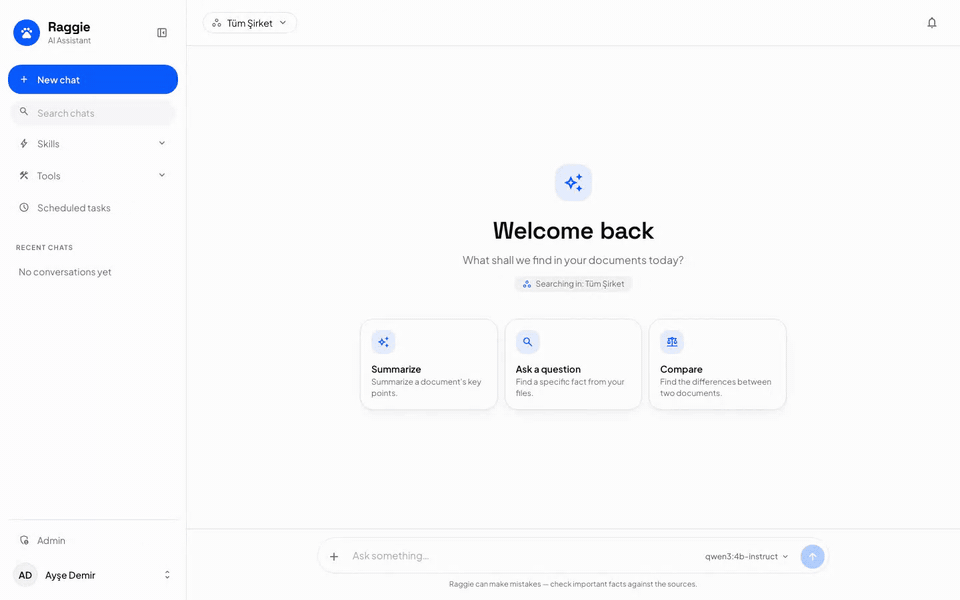
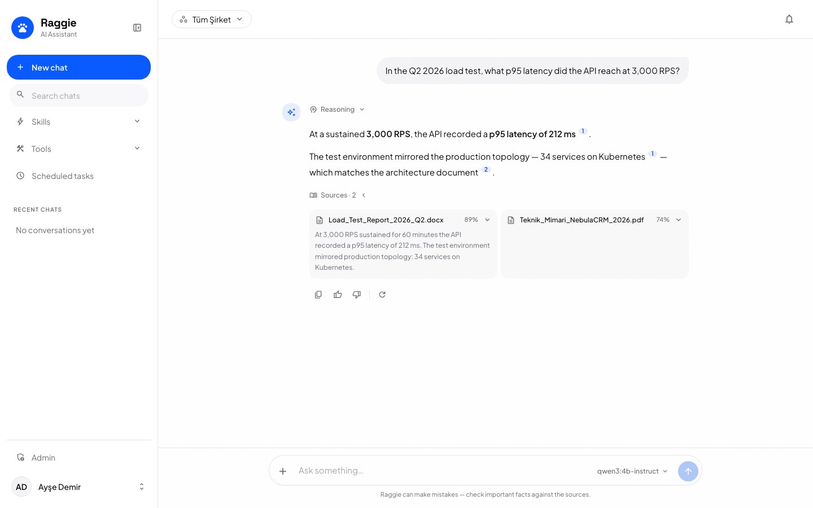
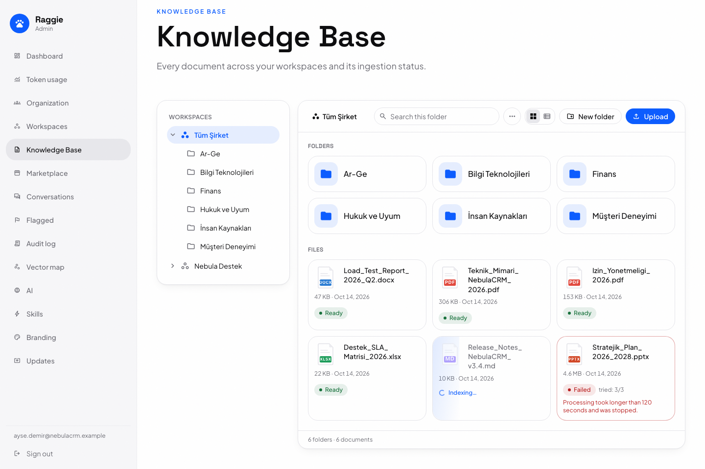
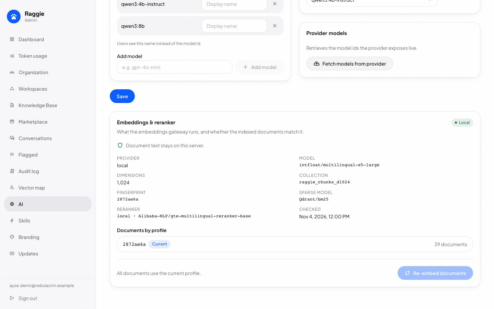
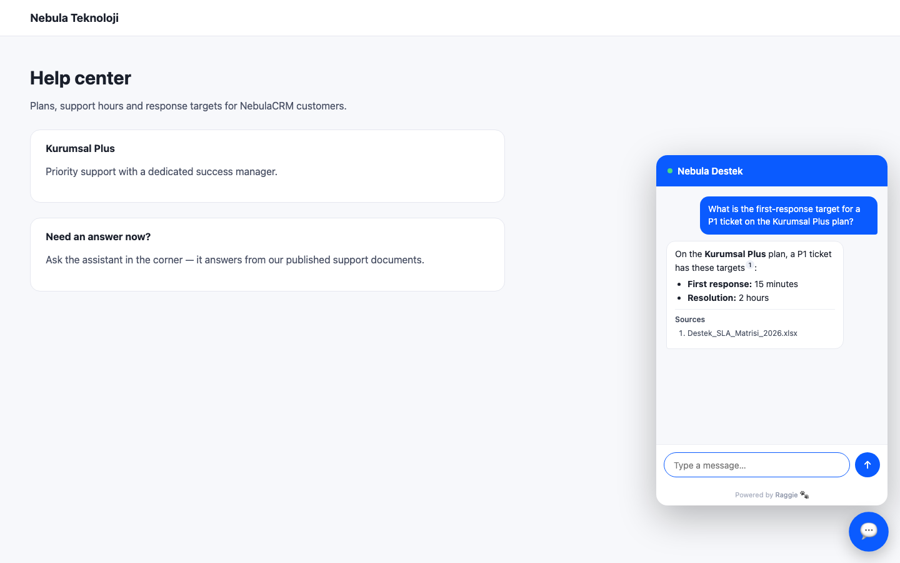
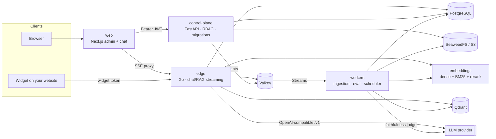

# Raggie

**Self-hosted RAG chat for teams and websites: upload your documents, get cited answers in Turkish or English, and run the whole stack (the model too, if you want) on your own servers.**

[](https://github.com/alicangunduz/raggie/actions/workflows/ci.yml)
[](LICENSE)
[](https://github.com/alicangunduz/raggie/releases)

[Türkçe README](README.tr.md)

<p align="center"></p>

> **Status: v0.1.0 Community Preview.** The core is usable and covered by tests,
> but performance numbers are still targets until benchmark reports are
> published. See [Known limitations](#known-limitations).

Raggie gives you two things on top of your own documents:

- **An internal assistant** for your teams: department-scoped workspaces,
  role-based access, answers with numbered citations back to the source.
- **An embeddable support widget** for your public website, isolated from the
  admin surface by design.

Completed answers are checked by an experimental LLM judge for faithfulness to
the retrieved sources and for citation quality, and low-scoring conversations
are flagged for review. The judge's accuracy has not been measured yet.

## Screenshots

| | |
|---|---|
|  |  |
| **Cited answers** with the passages they come from | **Knowledge base** with folders, live status and readable failure reasons |
|  |  |
| **Embeddings & reranker**: local by default, with any data egress shown | **Support widget** on your own website |

The screenshots show the real web UI with the synthetic *Nebula Teknoloji*
sample data (`examples/sample-corpus`); the answers are scripted from the golden
set (`examples/golden`) instead of a live model. Regenerate them with
`cd web && pnpm build && pnpm capture:readme`.

## Features

| Area | What you get | Maturity |
|---|---|---|
| Chat & retrieval | Hybrid search (dense + BM25, fused with RRF), reranking, numbered citations, streaming answers (SSE) | Stable |
| Ingestion | PDF, DOCX, XLSX, PPTX, TXT, MD; OCR for scanned PDFs and images (Tesseract, Turkish + English); uploads in 16 MiB parts (each part retried) up to 10 GiB | Stable |
| Multi-tenancy | Organization → Team (nested) → Workspace, RBAC (staff / workspace admin / super admin) | Stable |
| Embeddable widget | One `<script>` tag, Shadow DOM, per-workspace origin allow-list, separate token audience | Stable |
| Languages | Web UI in Turkish and English; answers follow the language of the question | Stable |
| Answer quality checks | Faithfulness and citation scoring by an LLM judge; flagged-conversation review (judge accuracy not yet benchmarked) | Experimental |
| Admin console | Users, teams, invites, branding, audit log, usage analytics, vector map | Beta |
| Skills & scheduled tasks | Reusable instruction presets; prompts that run on a schedule and notify you | Beta |
| Memory & personalization | Per-user facts and profile context in internal chats (configurable) | Beta |
| Web research | Brave Search with page reading and multi-query "deep research" (off by default) | Beta |
| MCP tools | Jira through `mcp-atlassian`, read-only by default (off by default) | Beta |
| Kubernetes | Kustomize manifests and a Helm chart with single-node and HA values | Beta (community preview) |
| Cloud embeddings | Optional OpenAI-compatible embeddings / remote reranker instead of local models | Experimental (not yet validated against a live provider) |
| SSO / SCIM | OIDC login and SCIM provisioning **APIs** (no login button in the web UI yet) | Experimental |

Maturity labels: **Stable** = core path, covered by automated tests, no breaking
changes planned. **Beta** = works, may change. **Experimental** = incomplete or
API-only.

## Quickstart

**Zero API keys, from source** (deterministic mock LLM, local embeddings):

```bash
git clone https://github.com/alicangunduz/raggie && cd raggie
make env && make up-demo
```

Open <http://localhost/onboarding> (the bundled Caddy front door on port 80;
set `HTTP_PORT` in `.env` if 80 is taken), create the first admin, then upload a
document and ask about it. The mock LLM answers with templated text that cites
the retrieved sources. `make demo` seeds a synthetic company with 39
sample documents. The first build bakes the embedding models into the image
(several GB; expect a few minutes). The `.env` created by `make env` uses
`RAGGIE_ENV=development`: fine for a laptop, **never for a server**.

**Real answers, still no API key:** `make env && make up-ollama` starts the same
stack with a bundled Ollama running `qwen3:4b-instruct` (Apache-2.0, ~2.5 GB,
Turkish and English; no GPU needed, but plan extra RAM for it). The first start
pulls the model. With an NVIDIA GPU use `make up-ollama-gpu`, and pick a larger
model with `OLLAMA_MODEL`.

To use any other OpenAI-compatible endpoint (OpenAI, vLLM, a hosted gateway),
set `LLMAAS_BASE_URL` in `.env` and run `make up-core`. See
[docs/llm-providers.md](docs/llm-providers.md).

**On a Linux server** the installer downloads a pinned, sha256-verified release
into `/opt/raggie`, generates every secret, starts the stack and prints the setup
token:

```bash
curl -fsSL https://github.com/alicangunduz/raggie/releases/latest/download/install.sh | sudo bash -s -- \
  --domain chat.example.com --acme-email ops@example.com --llm ollama
```

To check the installer itself before running it:

```bash
curl -fsSLO https://github.com/alicangunduz/raggie/releases/latest/download/install.sh
curl -fsSLO https://github.com/alicangunduz/raggie/releases/latest/download/SHA256SUMS
sha256sum -c --ignore-missing SHA256SUMS && sudo bash install.sh --domain chat.example.com
```

`--domain` gives automatic HTTPS (DNS must point at the server, ports 80/443
reachable). `--llm` is `mock`, `ollama` (bundled; `--ollama-model`, `--gpu
auto|yes|no`), `self-hosted` (your vLLM/Ollama URL) or `openai` (with
`--llm-base-url` / `--llm-api-key`); asked interactively, it suggests `ollama`
on hosts with 12 GB RAM or more, otherwise `mock`. Re-running it upgrades: `.env`
is backed up and its values are kept (new keys are appended). All options: `bash install.sh --help`. `--ref main`
installs a development snapshot that is **not** checksum-verified. See
[docs/production.md](docs/production.md).

## Hardware

Rough sizing for a small team (≤ 50 users, a few thousand documents). **These are
estimates until the benchmark reports land.**

| | Cloud LLM | Self-hosted LLM (Ollama / vLLM) |
|---|---|---|
| **Local embeddings** (default) | 4 vCPU · 8 GB RAM (16 GB recommended) · 40 GB disk | the left column **plus** the model: ~8 GB RAM for a 7–8B model on CPU (slow), or a GPU with ≥ 8 GB VRAM |
| **Cloud embeddings** (experimental) | 2 vCPU · 4 GB RAM · 20 GB disk | 2 vCPU · 4 GB RAM **plus** the model as above |

The local embedding service (multilingual-e5-large + reranker, CPU/ONNX) needs
about 3–4 GB of RAM on its own; no GPU is required. Disk grows with your
documents (raw files in object storage plus vectors in Qdrant).

## Architecture



- **edge** (Go) streams answers: embeds the question, runs hybrid search in
  Qdrant scoped to the workspace, reranks, builds the prompt and streams the LLM
  response.
- **control-plane** (Python/FastAPI) owns the database schema, authentication,
  RBAC and the admin API.
- **workers** (Python) parse and chunk uploads, embed and index them, score
  answers, and run scheduled tasks.
- **embeddings** serves local ONNX models (`intfloat/multilingual-e5-large`,
  `Qdrant/bm25`, `Alibaba-NLP/gte-multilingual-reranker-base`).

Details: [docs/ARCHITECTURE.md](docs/ARCHITECTURE.md).

## How it compares

Several good open-source projects overlap with Raggie. This is our honest
reading at the time of writing; check each project for current details, and
send a PR if we got something wrong.

| Project | Focus | License |
|---|---|---|
| [Dify](https://github.com/langgenius/dify) | Visual LLM app and workflow builder, agents, RAG | Modified Apache-2.0 (multi-tenant and branding conditions) |
| [RAGFlow](https://github.com/infiniflow/ragflow) | RAG engine centred on deep document parsing | Apache-2.0 |
| [AnythingLLM](https://github.com/Mintplex-Labs/anything-llm) | All-in-one desktop/Docker chat-with-docs app, many integrations | MIT |
| [Onyx](https://github.com/onyx-dot-app/onyx) | Enterprise search and chat with many data connectors | MIT (community edition) + commercial enterprise edition |
| [Open WebUI](https://github.com/open-webui/open-webui) | Self-hosted chat UI for Ollama/OpenAI with RAG | Open WebUI License (BSD-3-based, branding clause) |

Where Raggie is different:

- **On-premise first, Turkish and English.** UI, prompts and OCR are built for
  TR/EN out of the box. Parsing, embedding and search run locally by default, so
  documents are not sent anywhere to be indexed. The LLM you configure receives
  the retrieved passages with each question; with a self-hosted model, nothing
  leaves your server.
- **A hard boundary between the public widget and the admin surface.** Widget
  tokens use a separate audience and signing secret, are issued only to
  allow-listed origins for public workspaces, and never get MCP tools, memory or
  personalization (web search only if you turn on `WIDGET_WEB_SEARCH_ENABLED`
  and the workspace toggle).
- **Organization → Team → Workspace** with nested teams and RBAC, rather than a
  flat list of workspaces.
- **Numbered citations requested in every answer, sources always listed**:
  the internal chat lists every retrieved source under the answer, and the
  widget lists the sources the answer cites. Plus experimental faithfulness
  and citation scoring with a review queue for low scores.
- **A security test program in CI**: authorization-matrix tests that fail if any
  HTTP route lacks a policy, cross-tenant isolation tests, Go fuzzing, and
  secret/SAST/dependency/IaC scanners. See [docs/security-model.md](docs/security-model.md).

If you need a visual workflow builder (Dify) or many data-source connectors
(Onyx), those projects may suit you better.

## Known limitations

- **Benchmarks pending.** Every performance number in these docs is a design
  target. The harnesses that will measure them are in [`bench/`](bench/)
  (methodology: [docs/benchmarks](docs/benchmarks/README.md)); no results have
  been published yet.
- **MCP credentials are deployment-wide.** The Jira MCP server uses one operator
  credential shared by every organization; per-organization credentials are
  planned.
- **MCP write tools have a global switch only.** `MCP_ALLOW_WRITE_TOOLS` exposes
  tools that are not provably read-only to every workspace that has MCP enabled;
  a per-workspace toggle is planned for 0.2.
- **SSO is API-only.** OIDC and SCIM endpoints exist, but the web login page has no
  SSO button yet.
- **Kubernetes is a community preview.** The Helm chart and Kustomize manifests are
  not yet validated by failure drills: the HA chaos suite and the backup/restore
  drill have weekly CI workflows (`ha-chaos.yml`, `dr-drill.yml`), but no run has
  been published yet ([results](docs/benchmarks/ha-chaos.md)).
- **`*_FILE` secrets are control-plane only.** Only the control plane reads
  secrets from mounted files (`JWT_SECRET_FILE` and the like); the edge, workers
  and embeddings service take them from environment variables.
- **Cloud embeddings are experimental.** Per-profile collections, caller auth
  and installer presets are implemented and unit-tested, but no run against a
  live provider has validated them end to end yet.
- **No automatic retention.** Conversations, messages and audit logs are kept
  until deleted; workspace and organization deletion are not implemented yet.
  See [docs/data-handling.md](docs/data-handling.md).
- **No Postgres row-level security.** Tenant isolation is enforced in application
  code (and tested), not by the database.
- **One event bus.** Every service uses Valkey Streams; a Kafka/Redpanda
  adapter for large deployments is planned.

## Documentation

- [Getting started](docs/getting-started.md) · [Configuration reference](docs/configuration.md)
- [LLM providers](docs/llm-providers.md) · [Embeddings](docs/embeddings.md)
- [Production deployment](docs/production.md) · [Upgrades](docs/upgrade.md) · [Backup & restore](docs/backup-restore.md)
- [Security model](docs/security-model.md) · [Data handling (KVKK/GDPR)](docs/data-handling.md)
- [Architecture](docs/ARCHITECTURE.md) · [FAQ](docs/faq.md) · [Roadmap](docs/COMMUNITY_ROADMAP.md)

## Contributing

Contributions are welcome. Read [CONTRIBUTING.md](CONTRIBUTING.md) (DCO sign-off,
tests, i18n and authorization rules) and our [Code of Conduct](CODE_OF_CONDUCT.md).
Report vulnerabilities privately as described in [SECURITY.md](SECURITY.md).

## License

Apache-2.0. See [LICENSE](LICENSE). The name and logo are covered by
[TRADEMARKS.md](TRADEMARKS.md).
