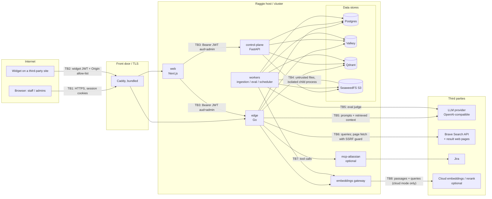

# Security model

This document describes how Raggie is put together from a security point of
view: which components trust which, what an attacker could try at each
boundary, what the code does about it, and what is still a known gap. It is
written against the current code; file references point into the repository.

To report a vulnerability, see [SECURITY.md](../SECURITY.md). For what data
leaves the server and how deletion works, see [data-handling.md](data-handling.md).

## 1. System overview

Raggie is a set of services behind one public entry point:

| Component | Role | Exposed to |
|---|---|---|
| `web` (Next.js) | Admin console and internal chat UI; server-side proxy to the APIs | Browsers, through the Caddy front door |
| `edge` (Go) | Chat/RAG streaming (SSE), retrieval, widget token issuance, widget loader | Browsers via `web`; widget visitors through Caddy (widget and chat-stream paths only) |
| `control-plane` (FastAPI) | Admin/management API, auth, RBAC, migrations | Only `web` (published on `127.0.0.1` in compose) |
| `workers` (Python) | Ingestion (parse → chunk → embed → index), auto-evaluation, scheduler | Internal only |
| `embeddings` (Python) | Embedding / sparse / rerank gateway | Internal only |
| Postgres, Valkey (Redis API), Qdrant, SeaweedFS (S3 API) | Data stores | Internal only (compose binds them to `127.0.0.1`) |

## 2. Assets and actors

**Assets:** uploaded documents and their extracted chunks; conversations and
answers; user accounts, password hashes and sessions; per-user memory facts and
profile data; the shared secrets (`JWT_SECRET`, `WIDGET_TOKEN_SECRET`,
`INTERNAL_API_SECRET`, `INTEGRATION_ENC_KEY`, datastore passwords); third-party
API keys (LLM, Brave, Jira); the audit log.

**Actors:**

| Actor | Description |
|---|---|
| Anonymous visitor | Reaches the login and onboarding pages only |
| Widget visitor | Anonymous user of an embedded widget on an allow-listed site |
| `STAFF` | Member of one or more workspaces; can chat |
| `WORKSPACE_ADMIN` | Manages the workspaces they belong to and org-level settings in their own org |
| `SUPER_ADMIN` (org) | Full control inside **their own organization** |
| Platform admin | A `SUPER_ADMIN` with `is_platform_admin`; operator authority across all orgs and platform-wide settings |
| Operator | Has shell/infra access to the host or cluster (fully trusted) |

## 3. Trust boundaries (STRIDE)

The tables list the main threats per boundary, the mitigation in the code and
what remains. S/T/R/I/D/E = Spoofing, Tampering, Repudiation, Information
disclosure, Denial of service, Elevation of privilege.

### TB1 — Browser ↔ web

| | Threat | Mitigation | Residual risk |
|---|---|---|---|
| S | Session theft via XSS | Session cookies are `httpOnly`, `SameSite=Lax`, `Secure` in production (`web/lib/session-cookies.ts`). CSP with `connect-src 'self'`, `object-src 'none'`, `frame-ancestors 'none'` (`web/next.config.ts`). | CSP allows `'unsafe-inline'` scripts (Next.js inline runtime); a nonce-based CSP is planned. |
| T | Cross-site request forgery | Every mutating `/api/*` handler is wrapped in an Origin/Referer check (`web/lib/security/origin.ts`); a unit test fails if a new handler is not wrapped. Server actions use Next.js' built-in origin check. | — |
| I | Data exfiltration through model output (markdown images) | Model-rendered images are allowed only for same-origin or inline raster data URLs; other images render as links (`web/lib/security/url.ts`). CSP `img-src 'self' data: blob:` backs it up. | Links still render and can be clicked deliberately. |
| I | Clickjacking | `frame-ancestors 'none'` + `X-Frame-Options: DENY`. | — |
| S | Credential stuffing / brute force | Per-account progressive lockout (5 failures / 15 min → 30 s doubling to 15 min, Redis-backed) and a per-IP limit on `/login` and `/refresh` (20 / 60 s) in the control plane. | The per-IP limit is in-process **per replica**. |
| I | Downgrade to HTTP | HSTS is opt-in (`ENABLE_HSTS=true`) because many on-prem installs run on plain HTTP inside a LAN. | Operators must terminate TLS and enable HSTS themselves (see [production.md](production.md)). |

### TB2 — Widget visitor ↔ edge

| | Threat | Mitigation | Residual risk |
|---|---|---|---|
| E | Widget token used against admin APIs | Widget tokens have `aud=widget` and are signed with a **separate** `WIDGET_TOKEN_SECRET`. Admin routes on the edge and every control-plane route require `aud=admin` + `type=access` + a live session. Covered by the authz matrix tests and `services/control-plane/tests/test_widget_admin_isolation.py`. | — |
| S | Embedding the widget on an unapproved site | Tokens are issued only to an `Origin` that exactly matches the workspace's `cors_allowed_origins`; wildcards are rejected when the list is saved; only `EXTERNAL` workspaces issue tokens. The Origin is checked again on every chat request. | `Origin` is a browser control; a non-browser client can forge it. The token only grants chat on that one public workspace, rate-limited. |
| I | Reading another visitor's conversation | Widget conversations are bound to the token's random session id (`sid`). | — |
| E | Widget chat reaching powerful features | MCP tools, personalization and memory never run for widget chats (`services/edge/internal/httpserver/memory_gate_test.go::TestChatMemoryGates`, `services/edge/internal/httpserver/llmsec_test.go::TestLLMSecWidgetSessionNeverGetsMCPTools`). Web and deep search, which make paid outbound calls, need `WIDGET_WEB_SEARCH_ENABLED=true` (default off) **and** the workspace toggle (`services/edge/internal/httpserver/widget_web_test.go::TestWidgetWebSearchIsDoubleGated`). | With both switches on, widget questions are sent to the search provider. |
| I/E | Server-side request forgery through image attachments | Attachments must be inline base64 `data:image/…` URLs of a PNG, JPEG, WebP or GIF image with a valid payload under 5 MB; any URL (e.g. `http://169.254.169.254/…`, which vLLM/LiteLLM would fetch) or SVG is refused with 400 before retrieval, for widget and internal chats (`services/edge/internal/httpserver/attachments_test.go::TestChatRejectsNonDataImageAttachments`, `::TestValidAttachment`). | — |
| T | Forged conversation history from the widget | Widget sessions ignore client-sent `history`; their history is the server-stored conversation bound to the token's `sid` (`services/edge/internal/httpserver/history_test.go::TestChatClientHistoryCannotInjectRoles`). | — |
| D | Abuse / cost exhaustion | Per-session (10/min) and per-IP (30/min) chat limits, token issuance limits (10/min per workspace+IP and 30/min per IP across workspaces; a non-UUID `workspace_id` is refused before any lookup — `services/edge/internal/httpserver/widget_token_hardening_test.go`), a request-body read deadline (`HTTP_BODY_READ_TIMEOUT_SECONDS`, body only, never the stream), bounded LLM concurrency, and a per-replica cap on concurrent chat streams (`EDGE_MAX_SSE_CONNECTIONS`, default 12,500): past it a chat gets 503 `busy` + `Retry-After` before any stream byte (`services/edge/internal/httpserver/stream_limit_test.go::TestChatStreamCapShedsBeforeTheStream`, `::TestStreamLimiterAdmitsUpToTheCap`). | Rate limits are Redis-backed and **fail open** (see §9); the stream cap is per replica, not cluster-wide. |

### TB3 — web ↔ control-plane / edge

| | Threat | Mitigation | Residual risk |
|---|---|---|---|
| S | Forged tokens | HS256 JWTs pinned to the algorithm and audience; access tokens carry `sid` and are rejected if the `auth_sessions` row is revoked or the user is inactive. | All services share `JWT_SECRET`; leaking it compromises auth. |
| E | Privilege escalation via role grants | Nobody can grant a role above their own; platform admin can only be granted by a platform admin, only to an active `SUPER_ADMIN`, and the last platform admin cannot be revoked. | — |
| E | Cross-org access (IDOR) | Every org/workspace route resolves authorization through the `Authorizer` (§4); cross-org access returns 403/404. 24 cross-org tests plus the authz matrix. | No database-level row security (§5). |
| S | Spoofed client IP to bypass limits | The control plane trusts `X-Forwarded-For` only from configured proxy CIDRs. The web tier forwards the chain it receives. | The bundled Caddy overwrites `X-Forwarded-For` with the socket peer. If you put another proxy or CDN in front of it, add that proxy to Caddy's `trusted_proxies`, or every visitor shares its IP ([production.md](production.md)). |
| I | Admin API exposed directly | The control plane is published on `127.0.0.1` only in compose; the browser never calls it directly. | — |

### TB4 — Workers ↔ uploaded files

| | Threat | Mitigation | Residual risk |
|---|---|---|---|
| D | Zip bombs, XLSX bombs, huge PDFs | ZIP central directory inspected before decompression (256 MiB expanded, ratio ≤ 100, ≤ 10k entries); XLSX opened read-only with sheet/row/column/cell limits; PDF page, OCR-pixel and extracted-character caps (`services/workers/raggie_workers/ingestion/parsing.py`). | Limits are tunable (`PARSER_*` settings); raising them raises risk. |
| E/T | Parser exploits | Every parse runs in a disposable child process that is killed on timeout (120 s default) (`ingestion/isolation.py`). | Same container/user as the worker; no seccomp/sandbox beyond that. |
| T | Path traversal via file names | Extension allow-list and filename sanitizing on upload (`control-plane/.../api/documents.py`); hypothesis fuzz test. | — |

### TB5 — Services ↔ LLM provider

| | Threat | Mitigation | Residual risk |
|---|---|---|---|
| I | Provider sees confidential content | Prompts contain the question, history, retrieved chunks and (if enabled) persona/memory — see [data-handling.md](data-handling.md). Use a self-hosted OpenAI-compatible model to keep this on-premises. | Inherent to using a hosted LLM. |
| T | Prompt injection through client-sent chat history | Client `history` only seeds an internal conversation's first turn and is reduced to plain `user`/`assistant` turns (newest `HISTORY_MAX_MESSAGES`, ≤ 8,000 characters each, tool fields dropped); system, tool and other roles never reach the model; stored history replaces it once the conversation has messages (`services/edge/internal/httpserver/history_test.go::TestChatClientHistoryCannotInjectRoles`, `::TestSanitizeClientHistory`). | A user can still put misleading text in their own first-turn history. |
| T | Prompt injection through documents or web pages | System prompts instruct the model to treat sources as data; the client cannot override the system prompt (it is rebuilt server-side from the workspace prompt and skill); MCP tools are read-only by default; reasoning streams are off by default. | **Mitigated, not solved.** A malicious document can still influence an answer. |

### TB6 — Edge ↔ web search

| | Threat | Mitigation | Residual risk |
|---|---|---|---|
| I/E | SSRF through result URLs (internal hosts, metadata endpoints) | Page fetches use a dedicated client: no proxy, http/https only, ≤ 3 redirects, DNS resolved and **only public IPs dialed** (private, loopback, link-local, CGNAT and other reserved ranges blocked), 5 s timeout, 1.5 MB cap, HTML/text content types only (`services/edge/internal/websearch/brave.go`). Fuzz targets cover the IP check, dialer and redirect rules. | — |
| I | Query disclosure to the search provider | Off by default globally (`WEB_SEARCH_ENABLED=false`), per workspace, and for widget visitors (`WIDGET_WEB_SEARCH_ENABLED=false`). | When enabled, queries go to Brave. |

### TB7 — Edge ↔ MCP (Jira)

| | Threat | Mitigation | Residual risk |
|---|---|---|---|
| E | Model performs writes in Jira | `MCP_ALLOW_WRITE_TOOLS=false` by default: only tools the server marks `readOnlyHint=true`, or unannotated tools whose name has a read verb and no write verb, execution marker (`sql`, `exec`, …) or chaining word (`and`/`or`/`then`), are exposed; `destructiveHint=true` or `readOnlyHint=false` always means write (`services/edge/internal/mcp/readonly_test.go::TestIsReadOnlyHeuristic`); the bundled `mcp-atlassian` container also runs with `READ_ONLY_MODE=true`. | Read access is still access (see next row). |
| I | One org reading another org's Jira data | The integration must be connected for the workspace's org by a platform admin, and only authenticated internal users can use it. | **The Jira credential is one deploy-wide credential shared by every org.** Per-org credentials are planned. Enable MCP only for single-org deployments or trusted orgs. |

### TB8 — Embeddings gateway ↔ cloud provider (optional)

| | Threat | Mitigation | Residual risk |
|---|---|---|---|
| I | Document text sent to a third party | Default is **local** models; nothing leaves the server. Cloud mode is an explicit, experimental opt-in (see [embeddings.md](embeddings.md)). | In cloud mode, passages and queries go to the configured provider. |
| S | Unauthenticated callers on the gateway | The gateway is internal-only (compose `expose`, k8s NetworkPolicy allows only the edge, the ingestion worker and the control plane). Callers send `INTERNAL_API_SECRET` as a bearer token on `/v1/*`; the gateway requires it in cloud mode (`EMBEDDINGS_REQUIRE_AUTH`). | A local-mode install without `INTERNAL_API_SECRET` relies on network isolation alone; set the secret to require auth everywhere. |

## 4. Authorization model

**Roles** (rank order): `STAFF` < `WORKSPACE_ADMIN` < `SUPER_ADMIN`, plus the
`is_platform_admin` flag (effective only while the user is active).
Code: `services/control-plane/raggie_control_plane/authz.py`.

**Actions:** `MANAGE_SYSTEM`, `MANAGE_ORG`, `VIEW_WORKSPACE`,
`USE_WORKSPACE_CHAT`, `MANAGE_WORKSPACE`.

**Decision rules:**

- A platform admin is allowed every action in every org.
- A `SUPER_ADMIN` is allowed every action **inside their own org** only.
- A `WORKSPACE_ADMIN` has `MANAGE_ORG` in their own org; workspace actions need membership.
- Workspace actions require effective membership: direct workspace membership or membership of an ancestor team (via a team closure table).
- Nobody can grant a role higher than their own.

**Platform-admin-only surfaces:** organization management, platform-admin
grants, re-index-all and retry-failed across all documents, AI model
configuration, branding, the update check, and org-scoped integrations (MCP).

| Capability | STAFF | WORKSPACE_ADMIN | SUPER_ADMIN (own org) | Platform admin |
|---|---|---|---|---|
| Chat in workspaces they belong to | ✓ | ✓ | ✓ (all org workspaces) | ✓ (all) |
| Manage own profile, password, memory, conversations | ✓ | ✓ | ✓ | ✓ |
| Upload / manage documents in a workspace | – | member workspaces | ✓ | ✓ |
| Manage org users, teams, invites, directory | – | ✓ (own org) | ✓ | ✓ |
| Read org conversations / audit / analytics | – | scoped | ✓ | ✓ |
| Configure widget origins for an EXTERNAL workspace | – | member workspaces | ✓ | ✓ |
| Branding, AI models, updates, org-scoped integrations | – | – | – | ✓ |
| Create orgs, grant platform admin | – | – | – | ✓ |

The edge applies the same rule for workspace access: active user **and** one
of platform admin, `SUPER_ADMIN` of the same org, workspace member, or member
of an ancestor team.

**Authz matrix tests.** Both APIs have a route-level authorization matrix that
fails when a route has no policy entry (or a policy names a route that no
longer exists), then checks every principal against every route:

- Edge: `services/edge/internal/httpserver/authz_matrix_test.go` (11 principals, two seeded orgs, real Postgres).
- Control plane: `services/control-plane/tests/security/test_authz_matrix.py` with `tests/security/authz_policy.yaml`.

Cross-org isolation has its own suite (`services/control-plane/tests/test_tenant_isolation.py`).

## 5. Tenant isolation

- **Postgres:** every org-scoped query is filtered by `org_id`, and workspace
  access goes through the membership rules above. There is **no Postgres
  row-level security** yet; isolation is enforced in application code and
  covered by tests. RLS is planned.
- **Qdrant:** all orgs share one collection per embedding profile (for the
  default model, `raggie_chunks_d1024`). Every point carries a `workspace_id`
  payload, which is indexed, and every search is filtered by the workspaces the
  caller may access. This is logical isolation in a shared collection.
- **Object store (SeaweedFS, or any S3 service):** objects are stored under
  per-workspace keys. Only the control plane and workers hold credentials;
  browsers never access the object store directly.
- **Widget:** limited to the one workspace in the token (`wid`).

## 6. Sessions and authentication

- Passwords: argon2id; policy 12–1024 characters, not blank (enforced server-side on every path that sets a password).
- Tokens: HS256 JWTs. Access token 8 h, refresh token 30 days (both configurable).
- Refresh tokens are stored hashed (sha256) and rotated on every use. Replaying the token that was just rotated out is tolerated for 30 s, so parallel requests don't fail. Any other reuse **revokes the whole session**.
- Sessions are revoked on logout (current session), password change, deactivation and role change (all sessions).
- The web tier refreshes tokens single-flight per refresh token, so concurrent tabs do not trigger reuse detection.
- **First-run bootstrap** requires a one-time setup token: either `SETUP_TOKEN` from the environment, or one generated at first boot and logged once. Only its sha256 is stored, the comparison is constant-time, and it is cleared after use. Bootstrap is serialized with an advisory lock and refused once a `SUPER_ADMIN` exists.
- SSO (OIDC) and SCIM exist as **experimental, API-only** features, off by default; there is no SSO button in the web UI yet.

## 7. Web tier hardening

- CSP: `default-src 'self'`; `connect-src 'self'`; `img-src 'self' data: blob:`; `object-src 'none'`; `frame-ancestors 'none'`. Fonts and icons are self-hosted; no third-party requests at runtime.
- Headers: `X-Content-Type-Options: nosniff`, `X-Frame-Options: DENY`, `Referrer-Policy: strict-origin-when-cross-origin`, a restrictive `Permissions-Policy`, no `X-Powered-By`.
- HSTS: opt-in via `ENABLE_HSTS=true`.
- CSRF: Origin/Referer check on mutating API routes (see TB1).
- Uploaded brand icons are served as raster types only (never SVG), with `nosniff` and a sandbox CSP.
- The control plane adds its own security headers (strict CSP outside development; HSTS on HTTPS requests). The edge serves JSON/SSE only and has no security-header middleware.

## 8. Production secret policy

`RAGGIE_ENV` decides how strict each service is. Any value other than
`development`, `dev`, `local`, `test` or `testing` — **including unset** — is
treated as production, and the service refuses to boot with default,
placeholder or short secrets:

| Service | Checked in production |
|---|---|
| control-plane | `JWT_SECRET`, `WIDGET_TOKEN_SECRET` (≥ 32 bytes); object-store (`MINIO_ROOT_PASSWORD`) and Postgres passwords (≥ 16 bytes); `INTEGRATION_ENC_KEY`, `SETUP_TOKEN`, `METRICS_TOKEN`, `SCIM_BEARER_TOKEN` when set (≥ 32 bytes); known default values for Qdrant/Redis |
| edge | `JWT_SECRET`, `WIDGET_TOKEN_SECRET` (required, ≥ 32 bytes); `INTERNAL_API_SECRET`, `METRICS_TOKEN`, `QDRANT_API_KEY` when set |
| workers | `INTERNAL_API_SECRET` when set (≥ 32 bytes); Postgres and object-store (`MINIO_ROOT_PASSWORD`) passwords (≥ 16 bytes) |
| embeddings | `INTERNAL_API_SECRET` (≥ 32 bytes, no placeholder) whenever caller auth is required (the default in cloud mode) |

Caveats:

- `.env.example` ships `RAGGIE_ENV=development` so a local checkout works out
  of the box. **Copying it to a production host disables these checks.**
  `install.sh` sets `RAGGIE_ENV=production` and generates every secret.
- The edge does not validate the LLM, Brave or database credentials.

## 9. Accepted risks and known gaps

| Gap | Impact | Status |
|---|---|---|
| MCP (Jira) uses one deploy-wide credential shared by every org | An org with MCP enabled can read whatever that Jira account can read | Per-org credentials planned; MCP is off by default |
| Edge widget JWT enforces `exp` only when the claim is present | Issued tokens always carry `exp`; only a token forged with the secret could omit it | Accepted; tightening planned |
| Edge rate limits fail open on Redis errors and are disabled without Redis | Abuse protection degrades during a Redis outage | Accepted (availability over strictness) |
| Control-plane per-IP auth limit is in-process per replica | N replicas allow N× the configured rate; the per-account lockout is shared via Redis | Accepted |
| Edge without `DATABASE_URL` | Outside `RAGGIE_ENV=development` the edge refuses to start; in development, chat answers 503 | Resolved (fails closed) |
| No Postgres row-level security | Isolation relies on application checks (tested) | Planned |
| Prompt injection | Mitigated, not solved | Ongoing |
| LLM provider sees prompt content | Inherent to hosted LLMs | Use a self-hosted model |
| Redis Streams have no `MAXLEN` | Streams grow without bound | Planned |
| Edge has no security-header middleware | JSON/SSE API only; headers are set by web and control-plane | Accepted |
| Embeddings gateway accepts unauthenticated calls when `INTERNAL_API_SECRET` is empty | Only a local install without a secret; production requires the secret, and once it is set the gateway requires it as the bearer | Accepted; set `INTERNAL_API_SECRET` (or `EMBEDDINGS_REQUIRE_AUTH=true`) |
| `.env.example` defaults to development mode | Secret checks off if copied to production | Documented; use `install.sh` |
| Creating a user or invite answers 409 for an e-mail already in use in any org | An org admin can tell whether an address has an account elsewhere | Accepted for 0.1: e-mail is the global sign-in identity |
| `RAGGIE_ENV=local`, `test` and `testing` relax the secret checks like `development` | A server started with one of them boots with default or weak secrets | Accepted (CI and the test suites need it); never use them outside a workstation or CI |

## 10. Security testing

- **Authorization matrix** on every route of the edge and the control plane; adding a route without a policy entry fails CI.
- **Tenant isolation** tests across two orgs; a widget-isolation test.
- **Fuzzing** (Go native fuzzing, run briefly on every PR via `make fuzz-short`): SSE/LLM stream parsing, locale parsing, the web-search SSRF guards (public-IP check, dialer, redirects, URL canonicalization, HTML extraction), MCP response decoding and the read-only tool filter, tool-argument normalization, rate-limit decisions, every JSON request body (chat, widget token, run-task), client-IP parsing, schedule parsing, widget JWT parsing. Python property-based tests (hypothesis) cover filename sanitizing and document parsing.
- **CI scanners:** gitleaks (secrets), semgrep (OWASP Top 10, secrets, project rules), bandit, gosec, govulncheck, pip-audit, `pnpm audit`, hadolint and trivy (Dockerfiles/IaC), compose and Kustomize validation.
- Web unit tests cover the URL/image allow-lists, CSRF origin check, forwarded-header handling and token refresh.

Found something? Please follow [SECURITY.md](../SECURITY.md) — do not open a public issue.
